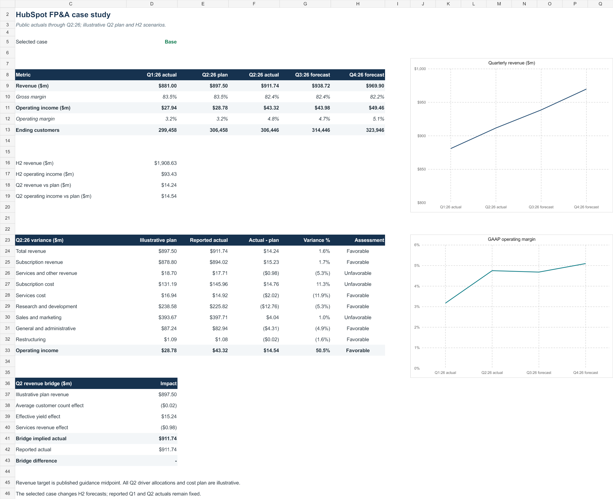

# HubSpot FP&A case study

An independent operating forecast and variance review using HubSpot's public results through June 30, 2026. This is a portfolio project by Chia-Tzu (Jenny) Tsai, not work performed for HubSpot.

## Open the project

- [Interactive Excel model](hubspot_fpa_model.xlsx): source actuals, editable assumptions, a driver-based operating model, and a dashboard.
- [One-page variance memo](hubspot_fpa_memo.pdf): Q2 results, a revenue driver bridge, H2 scenarios, and follow-up questions.

In the workbook, open **Assumptions** and change **Selected case** from 1 (Base) to 2 (Downside). The Q3 and Q4 forecast changes; Q1 and Q2 reported actuals do not. Blue numbers are editable scenario assumptions.

## What the model does

1. Derives Q1 2026 GAAP income statement figures from reported H1 less Q2 amounts.
2. Calculates subscription revenue from average beginning and ending customers times an effective quarterly revenue yield. Forecast customer counts roll forward with net additions.
3. Forecasts services revenue separately and applies explicit cost rates and operating expense ratios to calculate GAAP operating income.
4. Compares Q2 actual revenue with the midpoint of HubSpot's May 2026 public guidance. The customer and services assumptions used to split that benchmark, and the Q2 cost plan, are **illustrative analyst assumptions**.
5. Reconciles the Q2 revenue variance into average-customer, effective-yield, and services effects. The bridge difference is zero.

The effective quarterly yield is **subscription revenue divided by the average of beginning and ending customers**. It is a model proxy, not HubSpot's reported average subscription revenue per customer.

## Selected results

| USD millions unless noted | Base | Downside |
| --- | ---: | ---: |
| H2 2026 revenue | 1,908.63 | 1,844.12 |
| H2 2026 GAAP operating income | 93.43 | 34.13 |
| Q4 2026 ending customers | 323,946 | 314,946 |

Q2 reported revenue was $911.74 million, $14.24 million above the May guidance midpoint of $897.50 million. The modeled Q2 GAAP operating plan is hypothetical and should not be described as HubSpot's internal budget.

## Sources and limits

- [HubSpot Q2 2026 Form 10-Q](https://www.sec.gov/Archives/edgar/data/1404655/000119312526335232/hubs-20260630.htm): Q2 and H1 GAAP results, Q2 ending customers.
- [HubSpot Q1 2026 earnings release](https://www.sec.gov/Archives/edgar/data/1404655/000119312526211923/hubs-ex99_1.htm): Q1 ending customers and May Q2 revenue guidance.
- [HubSpot Q4 2025 earnings release](https://www.sec.gov/Archives/edgar/data/1404655/000119312526046563/hubs-ex99_1.htm): December 2025 ending customers.

The model uses public quarterly data. It does not contain HubSpot's internal monthly actuals, budget, retention, ARR, or cash-flow forecast. Q3 and Q4 are scenario estimates based on assumptions, not company guidance. The PDF memo is a snapshot of the workbook's original Base case.
